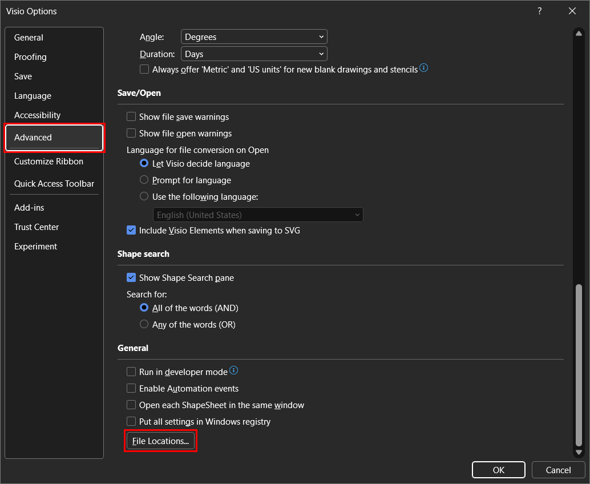
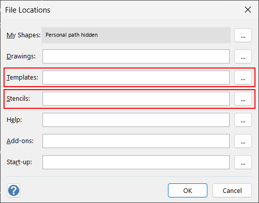

# Use your organization's shapes

Choose approved masters before drawing when shape meaning or consistency
matters. A stencil supplies shape masters; a template can also supply the
starting drawing.

## Make content discoverable

Place approved files in a known Visio content location:

| Content | Discovery locations |
| --- | --- |
| Stencils | Visio's My Shapes and registered Stencils locations, and the conventional `%USERPROFILE%\Documents\My Shapes` folder |
| Templates | Visio's registered Templates locations and `%APPDATA%\Microsoft\Templates` |

Registered Stencils and Templates locations include their subfolders. The
simplest option is to put stencil files in the folder shown under **My Shapes**,
which needs no further configuration. To check or add other folders in Visio:

1. Select **File > Options**, and then select **Advanced**.
2. Scroll down to **General**, and then select **File Locations...**.

   

3. In the **File Locations** dialog box, review the existing **Stencils** and
   **Templates** values before you replace them, and keep any paths you still need.
4. In **Stencils**, enter the folder that contains your custom stencil files, or
   select the ellipsis (**...**) button to browse to it. In **Templates**, do the
   same for the folder that contains your template files.

   

   In this screenshot, the personal **My Shapes** path is hidden for privacy; it
   isn't an example value.
5. Select **OK** to close **File Locations**, and then select **OK** to close
   **Visio Options**.

The Windows user running the server needs read access to these folders.

After adding, changing, or removing files, or changing content locations, ask:

> Refresh the Visio stencil index, then find the ApprovedArchitecture stencil
> and list its available Application, Service, and Data Store masters.

Refresh uses `manage_visio action="update_index"` and publishes the refreshed
snapshot before returning. It needs no Visio launch or server restart. Check
`failedStencilCount` for unreadable/unsupported sources; `persisted=false`
means the refresh is available in memory but wasn't written to the cache.

The server **doesn't import or copy** stencils from arbitrary folders.

## Discover and bind masters

Use `content_search` with `type="shape"` to find masters, or `type="stencil"`
or `"template"` to find files. Scope a shape search with `stencil` to distinguish
similarly named sources; an empty keyword can enumerate that indexed source.
Follow returned `nextOffset` for additional enumeration results.

Copy the returned **`masterId` unchanged into the shape's `NameU`**.
If supplying `stencilPath`, copy the matching **`path` from the same result**.
Keep that binding/source pair together; don't reconstruct it from a filename
or borrow a path from another match. Reuse the same binding for equivalent items.

Modern `.vssx`, `.vssm`, `.vstx`, and `.vstm` packages support master indexing.
Legacy `.vss` and `.vst` can appear as file entries without indexed masters.
Use a modern-format copy when master discovery is required.

## Test before standardizing

Try representative masters in a temporary drawing. Review resizing, text,
connectors, Shape Data, and actual container/list membership.

Ordinary automation suppresses add-on dispatch, with guarded exceptions for
required native container/swimlane behavior. Don't assume every macro, add-in,
or smart-shape behavior will run as in manual editing.

**Related:** [Custom agents](CUSTOM_AGENTS.md) to reuse approved mappings |
[Examples](EXAMPLES.md) for shape-selection prompts |
[Troubleshooting](TROUBLESHOOTING.md#drawing-results).
